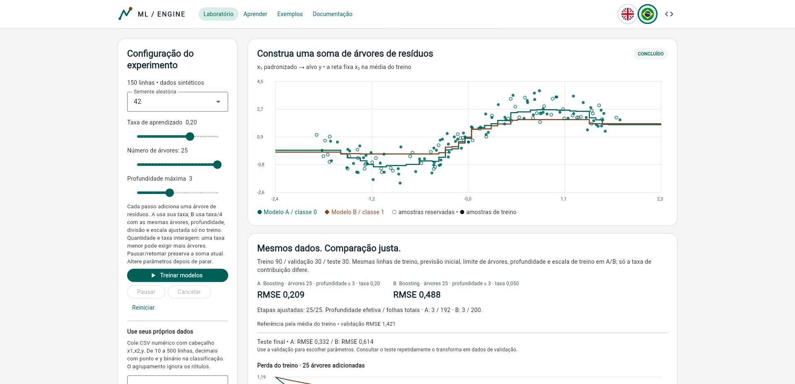

# ML Engine

[](https://github.com/kleberandrade/ml-engine/actions/workflows/verify.yml)
[](https://pub.dev/packages/ml_engine)
[](https://github.com/kleberandrade/ml-engine/releases/latest)
[](https://dart.dev/)
[](https://github.com/kleberandrade/ml-engine/blob/main/LICENSE)

**A pure Dart classical machine learning engine for Dart and Flutter applications.** Train models, apply fitted preprocessing and evaluate predictions through explicit APIs. The core has no third-party runtime dependencies, Flutter imports or platform I/O. The separate Flutter laboratory demonstrates the same engine.

**Version 0.6.1** · [API reference](https://pub.dev/documentation/ml_engine/latest/) · [Integration guide](https://github.com/kleberandrade/ml-engine/blob/main/doc/usage.md) · [Guia em português](https://github.com/kleberandrade/ml-engine/blob/main/doc/usage.pt-BR.md) · [Runnable examples](https://github.com/kleberandrade/ml-engine/tree/main/example)

## Install

```sh
dart pub add ml_engine
```

Or declare `ml_engine: ^0.6.1` under `dependencies` in your `pubspec.yaml`. Flutter applications can use the same package without adding the laboratory app.

## Fit, transform and predict

This complete example learns `y=3x+2`. A row is one sample; a column is one feature. The core supports any positive feature count, independently of the laboratory's two-feature display.

```dart
import 'package:ml_engine/ml_engine.dart';

void main() {
  final trainX = <List<double>>[[0], [1], [2], [3]];
  final trainY = <double>[2, 5, 8, 11];
  final pipeline = Pipeline(
    StandardScaler(),
    LinearRegression(learningRate: .05, iterations: 1000),
  )..fit(trainX, trainY);
  final predictions = pipeline.predict([[4], [5]]);
  print(predictions); // Approximately [14, 17].
  print(rootMeanSquaredError([14, 17], predictions)); // Near zero.
}
```

Pass raw query rows to `pipeline.predict`: the pipeline applies its already fitted scaler. Do not fit preprocessing on held-out rows or transform the input twice. See [example/quickstart.dart](https://github.com/kleberandrade/ml-engine/blob/main/example/quickstart.dart) for an executable check of these expected values.

## Choose an estimator

- **Regression:** `LinearRegression`, `RidgeRegression`, `KNNRegressor`, `DecisionTreeRegressor`, `RandomForestRegressor` and `GradientBoostingRegressor`. `predict` returns continuous target estimates.
- **Binary classification:** `LogisticRegression` and `GradientBoostingClassifier` require labels `0.0`/`1.0`. `predict` returns thresholded labels; `probabilities` returns sigmoid class-1 scores. These scores are not independently calibrated.
- **Numeric multiclass classification:** `KNNClassifier`, `DecisionTreeClassifier` and `RandomForestClassifier` accept arbitrary finite numeric labels. They expose hard predictions, not probabilities; vote ties choose the smallest label.
- **Clustering:** `KMeans` accepts features only and returns integer centroid indices. It has its own unsupervised `fit(x)` API and does not implement `Estimator`. Cluster IDs have no semantic class meaning.

Constructor defaults, parameter constraints, return values, complexity and exceptions are documented in the [API reference](https://pub.dev/documentation/ml_engine/latest/). Choose hyperparameters with validation/CV and reserve final-test data until selection is complete.

## Classification labels and probabilities

A pipeline returns the estimator's predictions. When calling a concrete model's additional API, apply the pipeline's fitted transform to its input:

```dart
final classifier = GradientBoostingClassifier(
  nEstimators: 1, maxDepth: 1, learningRate: .5,
);
final pipeline = Pipeline(StandardScaler(), classifier)
  ..fit([[0], [1], [2], [3]], [0, 0, 1, 1]);
final query = <List<double>>[[0], [3]];
final labels = pipeline.predict(query); // [0, 1]
final probabilities = classifier.probabilities(pipeline.transform(query));
final metrics = classificationMetrics([0, 1], labels);
print(probabilities); // Approximately [0.438, 0.562].
print(metrics.f1); // 1 on this small analytical fixture.
```

This fragment belongs inside `main` after importing the package. The complete [classification example](https://github.com/kleberandrade/ml-engine/blob/main/example/classification.dart) checks the result. `classificationMetrics` is **binary only** and expects thresholded labels, not probabilities. For multiclass models, supply an appropriate scorer to `crossValidate`.

`GradientModel.rawPredictions` returns sigmoid probabilities for logistic regression, whereas `GradientBoostingModel.rawPredictions` returns logits for its classifier. Prefer each classifier's `probabilities` method when probabilities are intended.

## Validation without leaking fitted state

```dart
final scores = crossValidate(
  xTrain,
  yTrain,
  kFold(xTrain.length, k: 5, seed: 42),
  () => Pipeline(StandardScaler(), KNNRegressor(k: 3)),
  rootMeanSquaredError,
);
```

Here `xTrain`/`yTrain` are application-owned training data. Return a **new pipeline, transformer and estimator** from the factory for every fold. Reused components are rejected. The result contains one score per fold; the metric determines whether lower or higher is better. Ensure KNN's `k` fits every fold's training size. [example/cross_validation.dart](https://github.com/kleberandrade/ml-engine/blob/main/example/cross_validation.dart) is a complete runnable example.

`trainValidationTestSplit` defaults to 60/20/20 and floors train/validation counts; `kFold` shuffles seeded indices; `stratifiedKFold` requires at least `k` samples per integer class. These splitters assume independent rows and do not handle repeated subjects, groups or time order automatically. Seeds reproduce within the same SDK; no cross-version random-algorithm guarantee is made.

## Input, state and errors

- `Matrix` is `List<List<double>>`. Fit and prediction require nonempty rectangular rows, positive feature width and finite numbers. Prediction feature count **and column meaning/order** must match training. Empty prediction batches are rejected. Targets contain one finite value per training row, with classifier-specific label restrictions.
- `Dataset` owns deeply immutable copies. Models own training values or retain immutable fitted nodes, as described by each class. Returned parameter/tree/history snapshots cannot be edited to mutate a model.
- Invalid shape, parameters or labels generally throw `ArgumentError`; calls requiring initialization throw `StateError`. The CSV parser throws `CsvFormatException` with a stable `CsvError` code and a one-based line when available. Numeric overflow and recovery rules are documented per method.
- KNN, decision trees, Random Forest and Gradient Boosting commit whole fits atomically. Gradient descent and K-means reset on a valid `start`; a later fitting failure retains the last complete state of that **new run**, not the preceding model. Train a separate candidate before replacing a serving model when transactional replacement matters.
- A failed `Pipeline.fit` invalidates that pipeline until a successful refit, because arbitrary components cannot be rolled back. Do not independently refit the pipeline's public components. Catch failures at an application boundary; do not serve predictions from an invalid pipeline.

Read the [integration and failure guide](https://github.com/kleberandrade/ml-engine/blob/main/doc/usage.md) before embedding fitting in a service or UI.

## Numerical conventions and scope

Linear/Ridge minimizes MSE/2, with Ridge adding `lambda * ||weights||² / 2` and leaving the intercept unpenalized. Lambda=0 gives linear updates; a sum-loss alpha corresponds to `n*lambda` here. KNN uses exact Euclidean search and uniform weights; equal distances follow training row order, including duplicates. Trees use greedy Gini/squared-error splits, root depth zero and positive-gain stopping; zero-gain XOR, pruning and categorical/missing-value routing are not supplied.

Random Forest bootstraps `n` rows per tree and uses `max(1, floor(sqrt(featureCount)))` features per node by default for **both** tasks. It aggregates hard class votes or numeric means, without OOB scores, probabilities or feature importance. Gradient Boosting uses all rows/features, residual regression trees and fixed shrinkage: mean initialization for regression, clipped prior log odds for binary classification. It is a first-order implementation without Newton leaf updates, line search or automatic early stopping. It is independent Dart code, **not XGBoost**.

`StandardScaler` uses population variance; constant training features map to zero with scale one. `MinMaxScaler` does not clip held-out values, which can fall outside `[0,1]`; constant features use range one. Regression metrics validate input vectors but extreme finite arithmetic can still overflow. R² for a constant target is 1 for exact predictions and 0 otherwise. Binary precision/recall/F1 return zero for zero denominators; directly constructing all-zero confusion counts produces NaN accuracy.

All training is synchronous. For prolonged work, use an isolate/worker appropriate to the target platform. The engine does not provide automatic schema encoding, missing-value imputation, calibration, serialization, hardware acceleration or production model monitoring. Those responsibilities belong to the integrating application. See [numerical conventions](https://github.com/kleberandrade/ml-engine/blob/main/docs/design.md) and [roadmap](https://github.com/kleberandrade/ml-engine/blob/main/docs/roadmap.md) for exact limits.

## Incremental training

Gradient models, boosting and K-means expose `start`/`step`. A successful step returns `true`; a completed budget/converged K-means returns `false`. Calling `predict` or reading a snapshot never advances training.

```dart
final model = GradientBoostingRegressor(
  nEstimators: 25, maxDepth: 3, learningRate: .2,
)..start(xTrain, yTrain);
while (model.step()) {
  print(model.lossHistory.last);
}
```

This loop is synchronous; yield between steps or run it outside a UI isolate as needed. Boosting `lossHistory` includes the initial constant prediction at index zero, then one value per tree. Gradient descent `costHistory` and K-means `costHistory` contain only post-update values. Boosting's objective is MSE/2 or mean binary cross entropy; K-means records total inertia. These are not interchangeable with validation RMSE/accuracy.

## Development and compatibility

Validated with **Dart 3.14.0 / Flutter 3.50.0**, framework `ab2912035e`. The package constraint is Dart >=3.12.0; earlier SDK versions have not been executed. Core tests cover Dart and the CI builds the JavaScript/CanvasKit Flutter lab. Wasm and native Flutter platform builds have not been validated. Lockfiles are committed; the lab's Flutter-constrained dependencies are recorded in the repository.

```sh
dart pub get
dart analyze
dart test
dart run example/quickstart.dart
dart run example/classification.dart
dart run example/cross_validation.dart
dart doc --validate-links --output /tmp/ml-engine-api
```

Public APIs require dartdoc comments and the analyzer treats missing documentation as an error. CI also generates the API reference, checks its links and executes these examples. Runtime implementation remains separate from the Flutter application.

## Flutter laboratory and learning material

[Open the PT/EN laboratory](https://kleberandrade.github.io/ml-engine/) to inspect the same models with bounded controls, validation metrics and real training stages. The lab lives in `apps/ml_lab`, remains non-publishable and is excluded from this package. Run it with `cd apps/ml_lab && flutter pub get && flutter run -d chrome`.



[English tutorial and five exercises](https://github.com/kleberandrade/ml-engine/blob/main/docs/tutorial.md) · [Architecture](https://github.com/kleberandrade/ml-engine/blob/main/docs/architecture.md) · [Deployment](https://github.com/kleberandrade/ml-engine/blob/main/docs/deployment.md) · [Release notes](https://github.com/kleberandrade/ml-engine/blob/main/docs/release-v0.6.1.md) · [Report an issue](https://github.com/kleberandrade/ml-engine/issues)

MIT licensed; dependencies retain their own licenses. No affiliation or compatibility with scikit-learn or XGBoost is implied.
