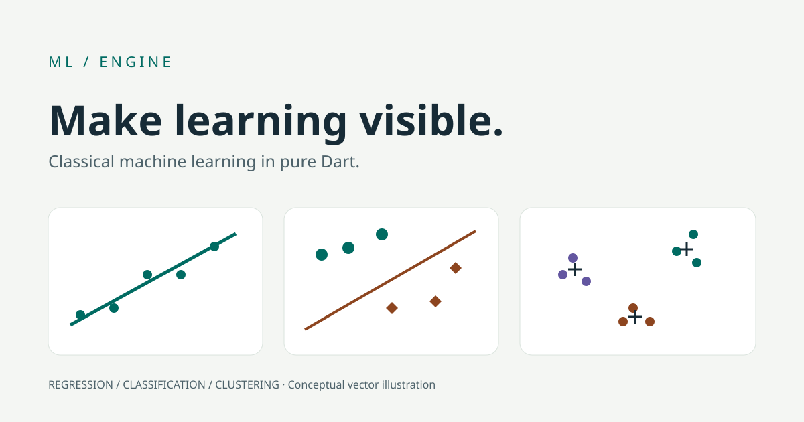
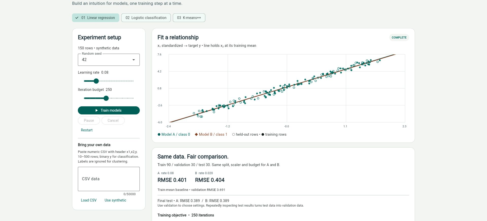

# ML Engine




A small, inspectable **pure Dart classical machine learning toolkit**, paired with a Flutter laboratory. Learn how fitting, preprocessing and evaluation work without mixing UI code into the mathematics. Complements fuzzy-engine, neural-engine, genetic-engine, reinforcement-engine, decision-engine and steering-engine.

**Local preview version 0.1.0.** No pub.dev package, GitHub repository or hosted demo has been published. `ml_engine` is a provisional package identity; public catalog requests returned HTTP 404 on November 17, 2026, which is not a reservation. Badges above describe the validated local toolchain and license, not remote CI or publication status.



## Included now

- Multivariate linear regression and binary logistic regression, intercepts, stable logistic loss and full-batch gradient descent with cost history.
- Seeded K-means++ initialization and Lloyd updates, inertia, centroids and prediction.
- StandardScaler (population variance), MinMaxScaler, and a fit/transform/predict pipeline.
- Seeded train/validation/test splits, shuffled K-fold, stratified K-fold and leakage-safe cross validation through fresh pipeline factories.
- MSE, RMSE, MAE, R², binary accuracy, precision, recall, F1 and confusion counts.
- Finite-value and shape checks, unfitted-state errors, constant-feature handling and explicit degenerate-case policies.
- A responsive Flutter lab: synthetic data, strict numeric CSV, scatter plots, fitted lines, probability regions and decision boundaries, centroids, cost curves, fair A/B runs and pause/resume/cancel/restart controls.

## Run

Validated with **Dart 3.14.0 / Flutter 3.50.0**, framework revision `ab2912035e`. Core SDK constraint is >=3.12.0; earlier Dart versions have not been executed. The lab requires Dart >=3.14.0 and Flutter >=3.50.0, using standalone `material_ui` 1.11.1. Core runtime has no third-party dependencies. Lockfiles are committed for reproducibility.

```sh
dart pub get
dart test
dart run example/main.dart
cd lab
flutter pub get
flutter test
flutter analyze
flutter run -d chrome
```

Release build:

```sh
cd lab
flutter build web --release --no-wasm-dry-run
python3 -m http.server 8769 --bind 127.0.0.1 --directory build/web
```

Open http://127.0.0.1:8769 in a browser. The verified build targets JavaScript with CanvasKit, not Wasm. `--no-wasm-dry-run` skips an optional compatibility probe; no Wasm compatibility claim is made. The lab is Web-only in this delivery; no Android/iOS/desktop build has been checked.

## Use the core

```dart
import 'package:ml_engine/ml_engine.dart';

final pipeline = Pipeline(
  StandardScaler(),
  LinearRegression(learningRate: .1, iterations: 1000),
);
pipeline.fit([[1], [2], [3]], [3, 5, 7]);
final predictions = pipeline.predict([[4]]); // approximately [9]
final transformed = pipeline.transform([[4]]); // train-fitted scaling
```

For local consumption, use `ml_engine: {path: /absolute/path/to/ml-engine}` in a Dart application's dependencies. Do not use a hosted dependency until a package actually exists.

```dart
Pipeline create() => Pipeline(StandardScaler(), LinearRegression());
final scores = crossValidate(x, y, kFold(x.length, k: 5, seed: 42),
    create, meanSquaredError);
// For binary classes: stratifiedKFold(y.map((v) => v.toInt()).toList()).
```

Never fit a scaler before splitting the full dataset. `crossValidate` calls the factory inside each fold and rejects reused pipelines, scalers or estimators. It accepts nonempty, disjoint, valid fold indices; use the provided fold constructors for exhaustive test coverage. Keep an untouched test set outside model selection.

For interactive training, call `start(x, y)` and then `step()` between event-loop yields; `fit` is synchronous and intended for small datasets or an isolate. The Flutter lab does one iteration per 16 ms timer tick on at most 500 rows with two features. It cancels timers on restart, import, experiment changes and disposal. This bounded policy is not a performance guarantee for arbitrary machines or high-dimensional data.

## Lab workflow

Choose an experiment, seed, rate (or cluster count), and iteration budget. Train A/B on the same 60/20/20 split and train-fitted standardization. B uses one quarter of A's learning rate, or the next seed for clustering. Validation scores and a train-derived baseline support comparison; final test scores appear after completion. Labels are unused in clustering. Regression lines hold the second standardized feature at zero, so a CSV with two varying features is shown as a partial slice rather than a full 3D fit.

CSV uses the exact header `x1,x2,y`, followed by 10–500 finite numeric rows in the lab; no quoted fields, missing values or thousands separators. Binary classification requires y in {0,1}. The lab caps absolute magnitudes at 1,000,000. Bad imports preserve the current experiment. Fix the displayed row error and retry, or restore synthetic data. The core parser accepts 2–500 rows; the lab needs at least 10 to keep its partitions meaningful.

## Documentation

- [Tutorial and five practical exercises](doc/tutorial.md)
- [Numerical conventions and extensibility](doc/design.md)
- [Validation record and known limits](doc/validation.md)
- [Roadmap](doc/roadmap.md)
- [Português: guia rápido](doc/quickstart.pt-BR.md)
- [Action log](doc/work-log.md)
- [Prepared GitHub metadata](doc/github-metadata.json)

## License and credits

MIT for this project's original code and visual design; dependencies retain their own licenses. Algorithms are implemented here from their mathematical definitions, with no vendored third-party algorithm source or datasets. Synthetic data is generated locally. Screenshots are actual captures of the running Flutter Web app; they are not conceptual illustrations. This project is not affiliated with XGBoost or SHAP.
