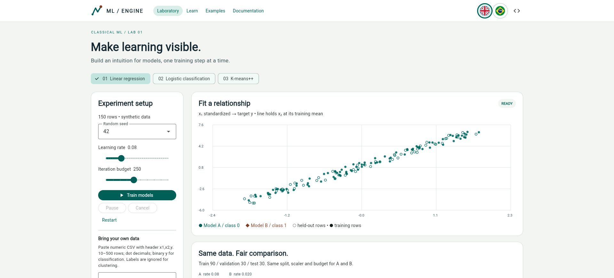

# ML Engine

[](https://github.com/kleberandrade/ml-engine/actions/workflows/verify.yml)
[](https://github.com/kleberandrade/ml-engine/releases/latest)
[](https://dart.dev/)
[](https://flutter.dev/)
[](LICENSE)


A small, inspectable **pure Dart classical machine learning toolkit**, paired with a Flutter laboratory. Learn how fitting, preprocessing and evaluation work without mixing UI code into the mathematics. Complements fuzzy-engine, neural-engine, genetic-engine, reinforcement-engine, decision-engine and steering-engine.

**Version 0.2.0.** Pure Dart classical ML, including Ridge regression with explicit L2 conventions, paired with the public Flutter laboratory. Source and release history: [kleberandrade/ml-engine](https://github.com/kleberandrade/ml-engine).

**[Open the live Flutter laboratory](https://kleberandrade.github.io/ml-engine/)**



## Included now

- Multivariate linear/Ridge regression (unpenalized intercept, configurable L2) and binary logistic regression, intercepts, stable logistic loss and full-batch gradient descent with cost history.
- Seeded K-means++ initialization and Lloyd updates, inertia, centroids and prediction.
- StandardScaler (population variance), MinMaxScaler, and a fit/transform/predict pipeline.
- Seeded train/validation/test splits, shuffled K-fold, stratified K-fold and leakage-safe cross validation through fresh pipeline factories.
- MSE, RMSE, MAE, R², binary accuracy, precision, recall, F1 and confusion counts.
- Finite-value and shape checks, unfitted-state errors, constant-feature handling and explicit degenerate-case policies.
- A responsive EN/PT-BR Flutter lab with an original vector identity, state-preserving navigation, an integrated Learn guide and executable examples: synthetic data, strict numeric CSV, scatter plots, fitted lines, probability regions and decision boundaries, centroids, cost curves, fair A/B runs and pause/resume/cancel/restart controls.

## Run

Validated with **Dart 3.14.0 / Flutter 3.50.0**, framework revision `ab2912035e`. Core SDK constraint is >=3.12.0; earlier Dart versions have not been executed. The lab requires Dart >=3.14.0 and Flutter >=3.50.0, using standalone `material_ui` 1.11.1. Core runtime has no third-party dependencies. Lockfiles are committed for reproducibility.

```sh
dart pub get
dart test
dart run example/main.dart
cd apps/ml_lab
flutter pub get
flutter test
flutter analyze
flutter run -d chrome
```

Local release build (served at the root):

```sh
cd apps/ml_lab
flutter build web --release --no-wasm-dry-run
python3 -m http.server 8769 --bind 127.0.0.1 --directory build/web
```

The GitHub Pages workflow builds with `--base-href /ml-engine/ --no-web-resources-cdn --web-content-hash`, verifies the manifest and runtime paths, and deploys the tested artifact only after all checks pass. Pull requests cannot deploy. See [deployment details](https://github.com/kleberandrade/ml-engine/blob/main/docs/deployment.md).

Open http://127.0.0.1:8769 in a browser. The verified build targets JavaScript with CanvasKit, not Wasm. `--no-wasm-dry-run` skips an optional compatibility probe; no Wasm compatibility claim is made. The lab is Web-only in this delivery; no Android/iOS/desktop build has been checked.

## Use the core

```dart
import 'package:ml_engine/ml_engine.dart';

final pipeline = Pipeline(
  StandardScaler(),
  LinearRegression(learningRate: .1, iterations: 1000),
);
pipeline.fit([[1], [2], [3]], [3, 5, 7]);
final predictions = pipeline.predict([[4]]); // approximately [9]
final transformed = pipeline.transform([[4]]); // train-fitted scaling
```

The core package is prepared for pub.dev as `ml_engine` version 0.2.0. Once published, install with `dart pub add ml_engine`. Local development can use `ml_engine: {path: /absolute/path/to/ml-engine}`. Publication status is recorded in the release notes.

```dart
Pipeline create() => Pipeline(StandardScaler(), LinearRegression());
final scores = crossValidate(x, y, kFold(x.length, k: 5, seed: 42),
    create, meanSquaredError);
// For binary classes: stratifiedKFold(y.map((v) => v.toInt()).toList()).
```

Never fit a scaler before splitting the full dataset. `crossValidate` calls the factory inside each fold and rejects reused pipelines, scalers or estimators. It accepts nonempty, disjoint, valid fold indices; use the provided fold constructors for exhaustive test coverage. Keep an untouched test set outside model selection.

For interactive training, call `start(x, y)` and then `step()` between event-loop yields; `fit` is synchronous and intended for small datasets or an isolate. The Flutter lab does one iteration per 16 ms timer tick on at most 500 rows with two features. It cancels timers on restart, import, experiment changes and disposal. This bounded policy is not a performance guarantee for arbitrary machines or high-dimensional data.

## Ridge regression

```dart
final model = Pipeline(
  StandardScaler(),
  RidgeRegression(lambda: 1, learningRate: .05, iterations: 1000),
)..fit(xTrain, yTrain);
final predictions = model.predict(xValidation);
```

Ridge minimizes `mean((prediction-y)²)/2 + lambda*sum(w²)/2`. Its gradient adds `lambda*w`; the intercept is never penalized. Lambda is finite and nonnegative; `lambda: 0` gives exactly the linear optimizer. A sum-loss convention uses `alpha = n * lambda`, so parameters from other libraries must be converted. Scaling uses training rows only. Select lambda on validation/folds; regularization can increase bias and does not guarantee lower test error.

The Ridge lab compares A (Ridge) with B (linear), shows coefficient norms and supports λ from 0 to 3. Both use the same split, scaler, rate, zero initialization and iteration budget. Their training objectives differ: compare validation RMSE rather than cost-curve heights. The seeded example has correlated features; plotted lines are partial slices holding standardized x₂ at zero.

## Lab workflow

The navbar opens **Laboratory**, **Learn** and **Examples**, plus the real project documentation/GitHub links. English and Brazilian Portuguese cover controls, feedback, chart descriptions, help and the educational content. Language changes preserve the experiment, curve and CSV draft; the language preference is stored only when browser storage is available. Learn explains the shipped algorithms and formulas, links its sources, opens real seeded/CSV presets and ends with five practical exercises. Opening a preset intentionally replaces the current experiment. The [original rising-seed logo](https://github.com/kleberandrade/ml-engine/blob/main/apps/ml_lab/web/brand-mark.svg) is also the favicon.


Choose an experiment, seed, rate (or cluster count), and iteration budget. Train A/B on the same 60/20/20 split and train-fitted standardization. In Ridge mode A is Ridge and B is linear, with identical initialization and learning rate; only A has L2 regularization. Other regression/classification modes compare learning rates, and clustering compares seeds. Validation scores and a train-derived baseline support comparison; final test scores appear after completion. Labels are unused in clustering. Regression lines hold the second standardized feature at zero, so a CSV with two varying features is shown as a partial slice rather than a full 3D fit.

CSV uses the exact header `x1,x2,y`, followed by 10–500 finite numeric rows in the lab; no quoted fields, missing values or thousands separators. Binary classification requires y in {0,1}. The lab caps absolute magnitudes at 1,000,000. Bad imports preserve the current experiment. Fix the displayed row error and retry, or restore synthetic data. The core parser accepts 2–500 rows; the lab needs at least 10 to keep its partitions meaningful.

The language controls use locally drawn circular Brazil/United Kingdom flags, selected-state rings, localized tooltips/semantics, keyboard operation and 48-pixel touch targets. The original drawings are code-native and make no runtime image requests.

## Documentation

- [Architecture and project layout](https://github.com/kleberandrade/ml-engine/blob/main/docs/architecture.md)
- [Tutorial and five practical exercises](https://github.com/kleberandrade/ml-engine/blob/main/docs/tutorial.md)
- [Numerical conventions and extensibility](https://github.com/kleberandrade/ml-engine/blob/main/docs/design.md)
- [Validation record and known limits](https://github.com/kleberandrade/ml-engine/blob/main/docs/validation.md)
- [Roadmap](https://github.com/kleberandrade/ml-engine/blob/main/docs/roadmap.md)
- [Português: guia rápido](https://github.com/kleberandrade/ml-engine/blob/main/docs/quickstart.pt-BR.md)
- [Action log](https://github.com/kleberandrade/ml-engine/blob/main/docs/work-log.md)
- [GitHub metadata](https://github.com/kleberandrade/ml-engine/blob/main/docs/github-metadata.json)
- [Release notes](https://github.com/kleberandrade/ml-engine/blob/main/docs/release-v0.2.0.md)

## License and credits

MIT for this project's original code and visual design; dependencies retain their own licenses. Algorithms are implemented here from their mathematical definitions, with no vendored third-party algorithm source or datasets. Synthetic data is generated locally. Screenshots are actual captures of the running Flutter Web app; they are not conceptual illustrations. This project is not affiliated with XGBoost or SHAP.
