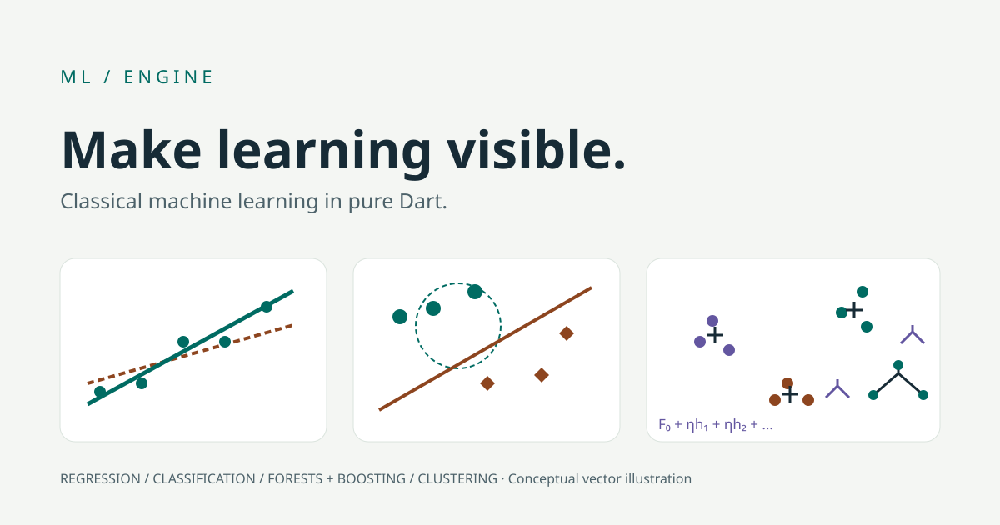
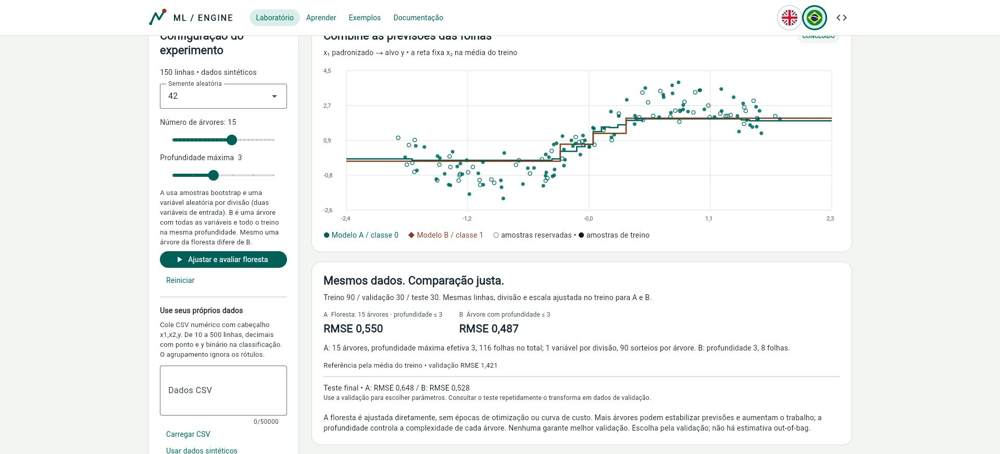

# ML Engine

[](https://github.com/kleberandrade/ml-engine/actions/workflows/verify.yml)
[](https://pub.dev/packages/ml_engine)
[](https://github.com/kleberandrade/ml-engine/releases/latest)
[](https://dart.dev/)
[](https://flutter.dev/)
[](LICENSE)



A small, inspectable **pure Dart classical machine learning toolkit**, paired with a Flutter laboratory. Learn how fitting, preprocessing and evaluation work without mixing UI code into the mathematics. Complements fuzzy-engine, neural-engine, genetic-engine, reinforcement-engine, decision-engine and steering-engine.

**Version 0.6.0.** Pure Dart classical ML, including Ridge, KNN, decision trees, Random Forest and Gradient Boosting with explicit numerical conventions, paired with the public Flutter laboratory. Source and release history: [kleberandrade/ml-engine](https://github.com/kleberandrade/ml-engine).

**[Open the live Flutter laboratory](https://kleberandrade.github.io/ml-engine/)**



## Included now

- Multivariate linear/Ridge regression (unpenalized intercept, configurable L2) and binary logistic regression, intercepts, stable logistic loss and full-batch gradient descent with cost history.
- KNN classification (finite numeric labels) and regression with uniform weights, Euclidean distance, configurable k and deterministic tie rules.
- Decision tree classification (Gini) and regression (squared error), max depth, minimum leaf size, immutable fitted nodes and deterministic greedy splits.
- Random Forest classification (hard votes) and regression (mean), seeded bootstrap, per-node feature subsets, tree-count/depth controls and immutable fitted metadata.
- Gradient Boosting regression (MSE/2) and binary classification (logistic loss) with residual regression trees, shrinkage, count/depth controls, stagewise start/step and immutable loss history.
- Seeded K-means++ initialization and Lloyd updates, inertia, centroids and prediction.
- StandardScaler (population variance), MinMaxScaler, and a fit/transform/predict pipeline.
- Seeded train/validation/test splits, shuffled K-fold, stratified K-fold and leakage-safe cross validation through fresh pipeline factories.
- MSE, RMSE, MAE, R², binary accuracy, precision, recall, F1 and confusion counts.
- Finite-value and shape checks, unfitted-state errors, constant-feature handling and explicit degenerate-case policies.
- A responsive EN/PT-BR Flutter lab with an original vector identity, state-preserving navigation, an integrated Learn guide and executable examples: synthetic data, strict numeric CSV, scatter plots, fitted lines, probability regions and decision boundaries, centroids, cost curves, fair A/B runs and pause/resume/cancel/restart controls.

## Run

Validated with **Dart 3.14.0 / Flutter 3.50.0**, framework revision `ab2912035e`. Core SDK constraint is >=3.12.0; earlier Dart versions have not been executed. The lab requires Dart >=3.14.0 and Flutter >=3.50.0, using standalone `material_ui` 1.11.1. Core runtime has no third-party dependencies. Lockfiles are committed for reproducibility.

```sh
dart pub get
dart test
dart run example/main.dart
cd apps/ml_lab
flutter pub get
flutter test
flutter analyze
flutter run -d chrome
```

Local release build (served at the root):

```sh
cd apps/ml_lab
flutter build web --release --no-wasm-dry-run
python3 -m http.server 8769 --bind 127.0.0.1 --directory build/web
```

The GitHub Pages workflow builds with `--base-href /ml-engine/ --no-web-resources-cdn --web-content-hash`, verifies the manifest and runtime paths, and deploys the tested artifact only after all checks pass. Pull requests cannot deploy. See [deployment details](https://github.com/kleberandrade/ml-engine/blob/main/docs/deployment.md).

Open http://127.0.0.1:8769 in a browser. The verified build targets JavaScript with CanvasKit, not Wasm. `--no-wasm-dry-run` skips an optional compatibility probe; no Wasm compatibility claim is made. The lab is Web-only in this delivery; no Android/iOS/desktop build has been checked.

## Gradient Boosting

```dart
final boost = GradientBoostingRegressor(
  nEstimators: 25, maxDepth: 3, learningRate: .2, minSamplesLeaf: 2,
);
boost.fit(xTrain, yTrain);
final predictions = boost.predict(xValidation);
// GradientBoostingClassifier supports binary 0/1 labels and probabilities(x).
// For observable stages: start(xTrain, yTrain); while (boost.step()) { ... }
```

Boosting builds a sum of residual trees, using all training rows/features. Regression starts at mean(y), fits y−F and adds rate×tree. Binary classification starts at clipped prior log odds, fits y−sigmoid(F) with **regression** trees and applies sigmoid to the additive logits. This is first-order boosting, without Newton leaf updates, line search, subsampling or automatic early stopping. It is an independent Dart implementation, **not XGBoost**. `lossHistory` includes the initial constant prediction then one loss per tree. Fit commits atomically; individual failed stages preserve their previous state. Core rate is (0,1]; lab bounds are 1–25 trees, depth 1–6 and rate .01–.3. A/B use the same count/depth/split with B at rate/4. More trees/depth can overfit; choose all three parameters on validation. See [ADR 0009](https://github.com/kleberandrade/ml-engine/blob/main/docs/adr/0009-first-order-gradient-boosting.md).

## Random Forest

```dart
final forest = RandomForestRegressor(
  nEstimators: 25, maxDepth: 4, minSamplesLeaf: 2, seed: 42,
);
forest.fit(xTrain, yTrain);
final predictions = forest.predict(xValidation);
// Use RandomForestClassifier for finite numeric class labels.
```

Every tree bootstraps n training rows with replacement and samples fresh features per split. The default feature count is `max(1, floor(sqrt(d)))` for **both** tasks; set `maxFeatures` explicitly to change it. Classification uses equal hard votes (smallest label wins a tie), regression averages tree predictions. These conventions may differ from other libraries. The lab bounds trees to 1–25 and depth to 1–6, comparing a forest against an all-feature, unbootstrapped tree at the **same depth**. One forest tree still differs from that reference. Inspect immutable roots, bootstrap indices and seeds; no OOB estimate, feature importance or probability API is implied. See [sampling and architecture](https://github.com/kleberandrade/ml-engine/blob/main/docs/adr/0008-seeded-bootstrap-random-forests.md).

## Use the core

```dart
import 'package:ml_engine/ml_engine.dart';

final pipeline = Pipeline(
  StandardScaler(),
  LinearRegression(learningRate: .1, iterations: 1000),
);
pipeline.fit([[1], [2], [3]], [3, 5, 7]);
final predictions = pipeline.predict([[4]]); // approximately [9]
final transformed = pipeline.transform([[4]]); // train-fitted scaling
```

The core is published as [`ml_engine 0.6.0`](https://pub.dev/packages/ml_engine/versions/0.6.0), including Gradient Boosting. Install with:

```sh
dart pub add ml_engine
```

For version 0.6.0, declare `ml_engine: ^0.6.0` in dependencies. Local development can use `ml_engine: {path: /absolute/path/to/ml-engine}`. The Flutter lab is a separate application and is not included in the package.

```dart
Pipeline create() => Pipeline(StandardScaler(), LinearRegression());
final scores = crossValidate(x, y, kFold(x.length, k: 5, seed: 42),
    create, meanSquaredError);
// For binary classes: stratifiedKFold(y.map((v) => v.toInt()).toList()).
```

Never fit a scaler before splitting the full dataset. `crossValidate` calls the factory inside each fold and rejects reused pipelines, scalers or estimators. It accepts nonempty, disjoint, valid fold indices; use the provided fold constructors for exhaustive test coverage. Keep an untouched test set outside model selection.

For interactive training, call `start(x, y)` and then `step()` between event-loop yields; `fit` is synchronous and intended for small datasets or an isolate. The Flutter lab does one iteration per 16 ms timer tick on at most 500 rows with two features. It cancels timers on restart, import, experiment changes and disposal. This bounded policy is not a performance guarantee for arbitrary machines or high-dimensional data.

## Ridge regression

```dart
final model = Pipeline(
  StandardScaler(),
  RidgeRegression(lambda: 1, learningRate: .05, iterations: 1000),
)..fit(xTrain, yTrain);
final predictions = model.predict(xValidation);
```

Ridge minimizes `mean((prediction-y)²)/2 + lambda*sum(w²)/2`. Its gradient adds `lambda*w`; the intercept is never penalized. Lambda is finite and nonnegative; `lambda: 0` gives exactly the linear optimizer. A sum-loss convention uses `alpha = n * lambda`, so parameters from other libraries must be converted. Scaling uses training rows only. Select lambda on validation/folds; regularization can increase bias and does not guarantee lower test error.

The Ridge lab compares A (Ridge) with B (linear), shows coefficient norms and supports λ from 0 to 3. Both use the same split, scaler, rate, zero initialization and iteration budget. Their training objectives differ: compare validation RMSE rather than cost-curve heights. The seeded example has correlated features; plotted lines are partial slices holding standardized x₂ at zero.

## K-nearest neighbors

```dart
final classifier = Pipeline(StandardScaler(), KNNClassifier(k: 3));
classifier.fit(xTrain, classLabels);
final classes = classifier.predict(xValidation);
final regressor = Pipeline(StandardScaler(), KNNRegressor(k: 5));
regressor.fit(xTrain, continuousTargets);
final estimates = regressor.predict(xValidation);
```

Both use Euclidean distance and equal weights. Classification takes the majority vote; tied class counts choose the smallest finite numeric label. Regression takes the mean of the k selected targets. Equal-distance neighbors at the k boundary follow original training row order. Duplicate rows count separately, including zero-distance matches. `k` must be in `1..trainingRows`, including within every CV fold. Fit copies and stores data; rejected refits preserve the previous model. Prediction checks shape, finite values and distance overflow.

The exact brute-force implementation sorts neighbors in `O(n*d + n log n)` time and `O(n)` extra memory per query; it has no KD-tree, inverse-distance weights, calibrated probabilities or learned extrapolation trend. Fit has no epochs, learning rate or objective curve. Use train-only scaling and select k on validation data. The lab compares your k against k=1, supports k up to `min(15, trainingRows)`, shows A only on its classification grid, and displays sampled A/B regression slices at standardized x₂=0. Changing k clears the result until **Evaluate neighbors** is clicked again. The lab stays bounded to 500×2; prolonged or high-dimensional workloads need a worker/isolate.

## Decision trees

```dart
final classifier = DecisionTreeClassifier(maxDepth: 3, minSamplesLeaf: 2);
classifier.fit(xTrain, classLabels);
final classes = classifier.predict(xValidation);
final regressor = DecisionTreeRegressor(maxDepth: 3, minSamplesLeaf: 2);
regressor.fit(xTrain, continuousTargets);
print(regressor.root.threshold); // Immutable fitted rule, or null for a leaf.
print(regressor.depth);          // Actual depth, which can be below the limit.
```

Numeric binary splits greedily reduce weighted Gini (classification) or within-node MSE (regression). Classification leaves use majority votes, choosing the smallest finite numeric label in a tie; regression leaves use means. Values `<= threshold` route left. Candidate thresholds are midpoints between adjacent distinct values, falling back to the lower value if rounding reaches the upper one. Equal gains within relative tolerance `1e-12` favor feature index, then threshold. Splits require an improvement greater than that tolerance; zero-gain XOR is deliberately not split. No global-optimality claim is made.

Root depth is zero; `maxDepth: 0` makes a constant leaf. `minSamplesLeaf` bounds each child of a split; datasets smaller than it still yield a root leaf. Pure/unsplittable nodes stop early. Trees expose immutable `root` nodes with prediction, sample count, impurity, feature index, threshold and children, plus actual `depth` and `leafCount`. Fit installs a fully built tree atomically; rejected numerical fits retain the old root. Finite numeric features/targets only: no missing-value routing, categorical splits, pruning or probabilities.

Trees need no feature scaling, but work with Pipeline/CV. The lab keeps its train-only scaler for shared plot axes. A compares your maximum depth (1–6) against B at depth 1, both with at least two training rows per leaf. It shows actual depth/leaves and A's first rule, direct fitting without fake optimizer controls, A-only classification regions and sampled regression steps at standardized x₂=0. More depth may overfit; select it on validation data. Fitting repeatedly sorts features per node and is synchronous; prediction is O(depth) per row. Large fits need an isolate/worker. Trees predict piecewise-constant leaves, not smooth extrapolation trends.

## Lab workflow

The navbar opens **Laboratory**, **Learn** and **Examples**, plus the real project documentation/GitHub links. English and Brazilian Portuguese cover controls, feedback, chart descriptions, help and the educational content. Language changes preserve the experiment, curve and CSV draft; the language preference is stored only when browser storage is available. Learn explains the shipped algorithms and formulas, links its sources, opens real seeded/CSV presets and ends with five practical exercises. Opening a preset intentionally replaces the current experiment. The [original rising-seed logo](https://github.com/kleberandrade/ml-engine/blob/main/apps/ml_lab/web/brand-mark.svg) is also the favicon.


Choose an experiment and seed. Iterative models use a rate (or cluster count) and iteration budget; KNN uses k and trees use max depth with direct evaluation. Evaluate A/B on the same 60/20/20 split and train-fitted standardization. In Ridge mode A is Ridge and B is linear, with identical initialization and learning rate; only A has L2 regularization. KNN compares k values and trees compare depth limits; other regression/classification modes compare learning rates, and clustering compares seeds. Validation scores and a train-derived baseline support comparison; final test scores appear after completion. Labels are unused in clustering. Regression lines hold the second standardized feature at zero, so a CSV with two varying features is shown as a partial slice rather than a full 3D fit.

CSV uses the exact header `x1,x2,y`, followed by 10–500 finite numeric rows in the lab; no quoted fields, missing values or thousands separators. Binary classification requires y in {0,1}. The lab caps absolute magnitudes at 1,000,000. Bad imports preserve the current experiment. Fix the displayed row error and retry, or restore synthetic data. The core parser accepts 2–500 rows; the lab needs at least 10 to keep its partitions meaningful.

The language controls use locally drawn circular Brazil/United Kingdom flags, selected-state rings, localized tooltips/semantics, keyboard operation and 48-pixel touch targets. The original drawings are code-native and make no runtime image requests.

## Documentation

- [Architecture and project layout](https://github.com/kleberandrade/ml-engine/blob/main/docs/architecture.md)
- [Tutorial and five practical exercises](https://github.com/kleberandrade/ml-engine/blob/main/docs/tutorial.md)
- [Numerical conventions and extensibility](https://github.com/kleberandrade/ml-engine/blob/main/docs/design.md)
- [Validation record and known limits](https://github.com/kleberandrade/ml-engine/blob/main/docs/validation.md)
- [Roadmap](https://github.com/kleberandrade/ml-engine/blob/main/docs/roadmap.md)
- [Português: guia rápido](https://github.com/kleberandrade/ml-engine/blob/main/docs/quickstart.pt-BR.md)
- [Action log](https://github.com/kleberandrade/ml-engine/blob/main/docs/work-log.md)
- [GitHub metadata](https://github.com/kleberandrade/ml-engine/blob/main/docs/github-metadata.json)
- [Release notes](https://github.com/kleberandrade/ml-engine/blob/main/docs/release-v0.6.0.md)

## License and credits

MIT for this project's original code and visual design; dependencies retain their own licenses. Algorithms are implemented here from their mathematical definitions, with no vendored third-party algorithm source or datasets. Synthetic data is generated locally. Screenshots are actual captures of the running Flutter Web app; they are not conceptual illustrations. This project is not affiliated with XGBoost or SHAP.
