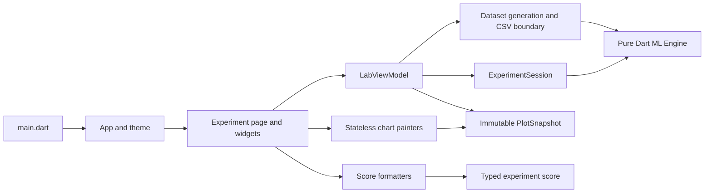

# Architecture and project layout

## Requirements

Maintain the existing pure Dart API and its numerical results while delivering a static Flutter Web demo under `/ml-engine/`. The lab must support seeded data, strict CSV validation, equal-budget comparisons, training lifecycle controls, readable charts and accessible desktop/mobile layouts. The deployment must run only after analysis, tests and a release build succeed. Training data stays in the browser; no backend is needed.

The bounded lab supports at most 500 rows and two features, yields between training iterations and uses immutable chart snapshots. Reproducibility, error recovery, dependency isolation and an understandable teaching codebase take priority over speculative extension layers.

## Layout

```text
ml-engine/
  lib/ml_engine.dart              public Dart facade (existing imports preserved)
  lib/src/
    data/                        matrix, dataset and numeric CSV boundaries
    models/                      estimator contract, gradient models and K-means++
    preprocessing/               transformer contract and scalers
    pipeline/                    train-fitted composition
    model_selection/             splits, folds and fresh-pipeline cross validation
    metrics/                     regression/classification scoring
  test/                          numerical tests grouped by core responsibility
  example/main.dart              executable Dart examples
  apps/ml_lab/
    lib/main.dart                entry point only
    lib/app/                     app composition, original branding, EN/PT-BR strings and browser adapters
    lib/features/experiments/
      data/                      synthetic generation and lab CSV policy
      domain/                    settings, typed scores and pure Dart training session
      application/               view model, timer lifetime and immutable plot snapshots
      presentation/              page, widgets, formatters and painters
    lib/features/learning/       bilingual topics, real executable presets and exercises
    test/features/experiments/    domain, application and presentation tests
    test/app/                    navigation, localization, keyboard and state-preservation tests
    web/                         Web shell and manifest
  docs/                          guides, decisions, evidence and screenshots
  tool/                          benchmarks and architecture validation
  .github/workflows/verify.yml   validation, tested artifact upload and Pages deploy
```

The root stays a conventional Dart package. The Flutter application consumes it with `path: ../..`; it is not a core runtime dependency. `example/` and `tool/` retain their standard Dart roles. Build outputs, generated package configuration and editor state remain ignored.

## Dependency direction



`LabViewModel` is the sole owner of the timer and training commands. Views configure it through validated commands; they cannot mutate settings fields directly. `ExperimentSession` owns the scaler, seeded split and A/B models; it emits typed scores rather than UI strings. Presentation formatters own wording and numeric display. Painters receive immutable numbers and sample labels, with no access to advance a training session.

A new CSV dataset is parsed and prepared before replacing active state. Failed imports preserve the old dataset and timer. Both K-means instances must initialize before a training session is installed. Failure is visible and synthetic data can recover the experiment. Disposal cancels pending updates.

`dart run tool/check_architecture.dart` enforces dependency direction: no framework/runtime package imports in the core, no Flutter or outward dependencies in data/domain, no presentation imports in application, and no mutable view model/session imports in painters. Numerical tests, timer tests and widget tests separately verify behavior; folder names alone are not architectural isolation.

## Decisions and operating limits

See [ADR 0001](adr/0001-separate-core-and-lab.md) and [ADR 0002](adr/0002-deploy-tested-pages-artifact.md). The view model follows Flutter's guidance on separating views and their state/commands, adapted to local deterministic data. There are no artificial service/repository layers for a nonexistent backend. ChangeNotifier is sufficient for one feature and avoids an additional state-management dependency.

Long or high-dimensional training still needs an isolate/worker. The 500-row lab limit and event-loop yielding are scoped to this teaching UI. The ML algorithms and public facade remain independent of Flutter, browser hosting and Pages permissions.

References: [Flutter architecture guide](https://docs.flutter.dev/app-architecture/guide), [Flutter Web deployment](https://docs.flutter.dev/deployment/web), [GitHub Pages custom workflows](https://docs.github.com/en/pages/getting-started-with-github-pages/using-custom-workflows-with-github-pages).

## Bilingual navigation and learning

The app shell owns one LabViewModel for its lifetime and retains Laboratory/Learn/Examples pages in an IndexedStack. Locale selection rebuilds localized views without replacing the experiment or its CSV editor. The app's browser adapter persists only `ml-engine.language` when localStorage is available and synchronizes the document language for accessibility. Blocked storage falls back to session behavior; CSV data and models are not persisted or transmitted. Material UI localization delegates translate framework controls as well as project strings.

The learning feature adapts the actual `docs/design.md` and `docs/tutorial.md` into EN/PT-BR content, formulas, four real model/data presets and exactly five exercises. It does not embed a GitHub iframe or present roadmap algorithms as implemented. See [ADR 0003](adr/0003-bilingual-learning-shell.md).

The language controls use locally drawn circular Brazil/United Kingdom flags, selected-state rings, localized tooltips/semantics, keyboard operation and 48-pixel touch targets. The original drawings are code-native and make no runtime image requests.

## Numerical failure recovery

[ADR 0004](adr/0004-reject-partial-training-state.md) defines failure behavior at the public core boundary. Scalers, K-means initialization and individual optimizer updates commit only validated candidate state. An exception leaves the previous statistics/iteration intact. This is atomicity per operation, not rollback of a complete multi-iteration `fit`. A failed Pipeline fit invalidates composition-level prediction and transformation until a successful fit, because arbitrary child implementations cannot be rolled back. Avoid mutating pipeline components independently.


## Ridge and package delivery

[ADR 0005](adr/0005-ridge-mean-loss-and-equal-budget-lab.md) adds Ridge as another GradientModel specialization, not another training framework. The experiment feature configures equal-rate Ridge/linear runs and exposes immutable coefficient norms. Presentation retains all language/number formatting. The publishable archive contains the Dart core, examples, tests and package metadata; the Flutter app stays in the repository/Pages artifact. CI validates both deliverables and never uploads a package itself.

## Nearest-neighbor evaluation

[ADR 0006](adr/0006-knn-uniform-votes-and-direct-evaluation.md) adds two Estimator implementations that store copied training data and predict through uniform Euclidean neighbors. KNN completes directly in the lab and does not reuse the iterative timer/cost UI. PlotBounds keeps sampled predictions aligned with axes. PredictionSamples contains immutable numeric values cached by LabViewModel until the experiment changes; renderers never query a mutable KNN model. Model selection remains train/validation based, with k checked against the training partition.

## Decision trees

[ADR 0007](adr/0007-greedy-numeric-decision-trees.md) adds two greedy numeric estimators with an immutable fitted tree. Core fitting uses sorted feature candidates and prefix/suffix losses, with atomic state replacement. The lab shares the direct-fit session/cache path with KNN and renders only sampled numeric predictions. Tree summaries read immutable node metadata; painters hold no tree estimator. Maximum depth and minimum leaf size bound the teaching experiment, while validation scores guide model selection.

## Random Forest extension (0.5.0)

Random Forest composes existing numeric trees and adds no package/runtime dependency. Optional tree feature subsampling retains the default all-feature behavior. Complete forests commit atomically, exposing immutable nodes and sampling metadata. The lab reuses the direct-fit session/snapshot/cache path and returns a domain ForestSummary of counts; painters never inspect models. A forest is compared with an all-feature full-training tree at equal depth. See [ADR 0008](adr/0008-seeded-bootstrap-random-forests.md). More trees increase synchronous work; bounded lab controls do not constitute a device-wide frame-time guarantee.
